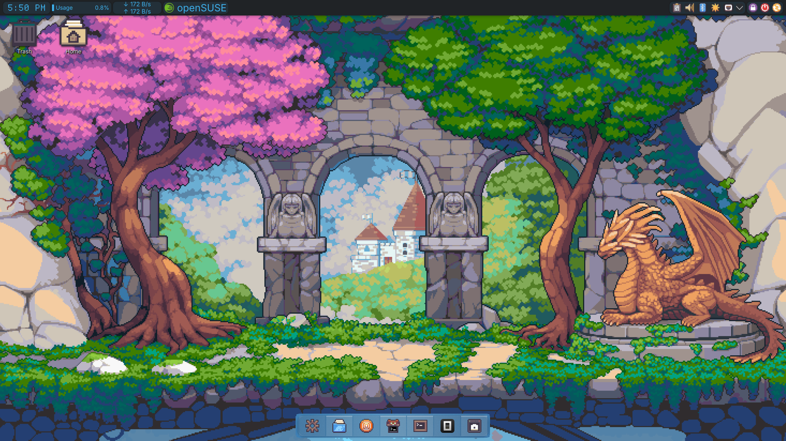
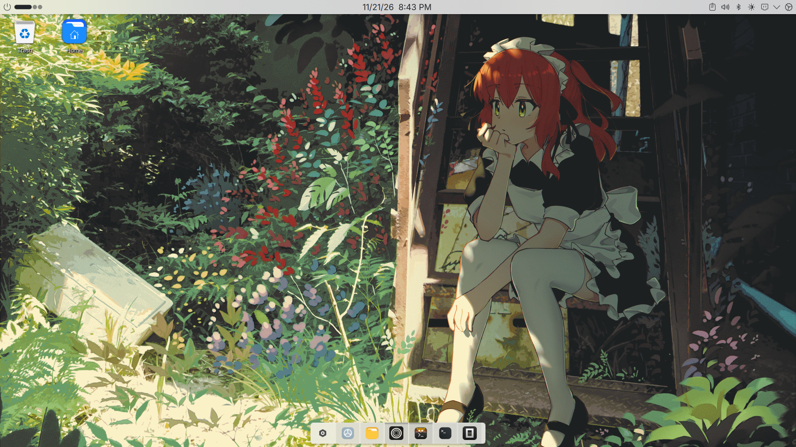

# linux-themes

My Linux desktop setups, each with screenshots and a one-command installer.

| Theme | Desktop | Preview |
|---|---|---|
| [**Pixora Dual-Bar**](kde-pixora-dualbar/) | KDE Plasma 6: pixel-art icons, pill top bar, floating dock |  |
| [**Gruvbox Klassy**](kde-gruvbox-klassy/) | KDE Plasma 6: Gruvbox, Klassy, Kara, Control Station, SilentSDDM |  |

Each folder has its own `README.md` with install and undo steps.

```bash
git clone https://github.com/strider-ape/linux-themes.git
cd linux-themes/<theme>
./install.sh
```

Switching themes: each installer backs up your current config to `~/plasma-backup-<timestamp>/` before changing anything, so you can always go back with that theme's `uninstall.sh <backup>`.
