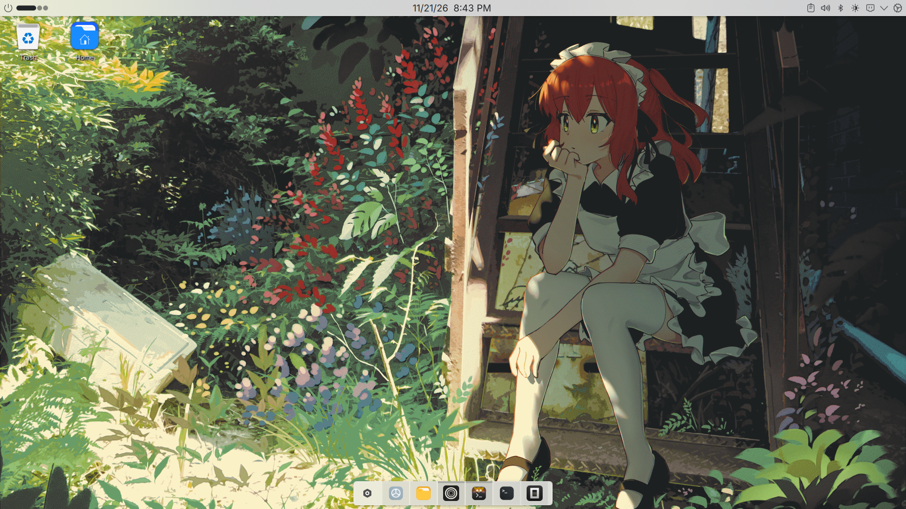
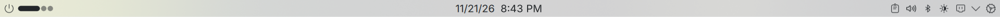

# Gruvbox Klassy (KDE Plasma 6)

A light top bar and a floating dock over a dark Gruvbox desktop. Window decorations and the app style use Klassy; workspaces show as Kara pills, Control Station is the quick-settings panel, and Andromeda is the launcher. Based on an r/unixporn post credited to u/Patrianovista, u/No-Support-2788 and u/Nuxpai.



**Top bar**


> These screenshots were taken before logging out, so Better Blur and Rounded Corners aren't visible yet.

## What's in it

| Part | What | Source | Needs |
|---|---|---|---|
| Global theme | Breeze Dark | built in | |
| Plasma style | Breeze Light (light panels and popups) | built in | |
| Colors | Gruvbox | [printesoi/kde-gruvbox](https://github.com/printesoi/kde-gruvbox) | |
| Icons | Reversal-blue-dark | [yeyushengfan258/Reversal-icon-theme](https://github.com/yeyushengfan258/Reversal-icon-theme) | |
| Cursor | Bibata-Modern-Ice v2.0.7 | [ful1e5/Bibata_Cursor](https://github.com/ful1e5/Bibata_Cursor) | |
| Splash | Kuro the cat | [bouteillerAlan/kuro](https://github.com/bouteillerAlan/kuro) | |
| Wallpaper | Kita (downloaded at install) | [gruvbox-wallpapers](https://gruvbox-wallpapers.pages.dev/wallpapers/anime/Kita.png) | |
| Workspaces | **Kara** in pill style | [dhruv8sh/kara](https://github.com/dhruv8sh/kara) | compiled into `~/.local` |
| Quick settings | **KDE Control Station** | [EliverLara/kde-control-station](https://github.com/EliverLara/kde-control-station) | |
| Launcher | **Andromeda Launcher**, opens in the screen center | [EliverLara/AndromedaLauncher](https://github.com/EliverLara/AndromedaLauncher) | |
| Effects | Sheet (built in), **Geometry Change** | [peterfajdiga/kwin4_effect_geometry_change](https://github.com/peterfajdiga/kwin4_effect_geometry_change) | |
| Effects | **Better Blur DX**, **Rounded Corners** | [xarblu/kwin-effects-better-blur-dx](https://github.com/xarblu/kwin-effects-better-blur-dx), [matinlotfali/KDE-Rounded-Corners](https://github.com/matinlotfali/KDE-Rounded-Corners) | sudo, compiled |
| Window decoration + app style | **Klassy** | [paulmcauley/klassy](https://github.com/paulmcauley/klassy) | sudo, compiled |
| Login screen | **SilentSDDM** | [uiriansan/SilentSDDM](https://github.com/uiriansan/SilentSDDM) | sudo |
| Window rule | 90% opacity for normal windows | built in | |

### Layout

```
┌──────────────────────────────────────────────────────────────────────────────┐
│ ⏻ ▬●●                         11/21/26  8:46 PM                    tray  ⚙  │  top: 32px, light
└──────────────────────────────────────────────────────────────────────────────┘

                       ╭──────────────────────────────────╮
                       │  ✦ │ ⚙  📁  🌐  🐱  …              │   dock: 48px, floating, centered
                       ╰──────────────────────────────────╯
```

- **⏻** opens the shutdown menu.
- **▬●●** is Kara: the long pill is the current workspace. The installer makes sure you have at least 3 workspaces.
- **⚙** on the right is Control Station: profile, wifi, bluetooth, brightness, Do Not Disturb, KDE Connect, Night Light, dark/light switch, volume and media.
- **✦** is Andromeda. It opens in the center of the screen.

## Install

Tested on openSUSE Tumbleweed-Slowroll with Plasma 6.8.3 on Wayland. The build dependencies are installed automatically on openSUSE (zypper) and Debian/Ubuntu (apt; the Debian names were checked against Debian Testing with Plasma 6.7); on other distros, the script lists them for you to install. It compiles with about one job per 2 GB of RAM, so a low-memory PC doesn't freeze; set `JOBS=n` to change that.

```bash
git clone https://github.com/strider-ape/linux-themes.git
cd linux-themes/kde-gruvbox-klassy

sudo ./install-system.sh   # 1. build tools, Klassy, Better Blur DX, Rounded Corners, SilentSDDM
./install.sh               # 2. everything else, as your normal user
```

Then **log out and back in**. KWin only loads newly compiled effects when it starts, and you'll see the Kuro splash and the SilentSDDM login screen.

`install.sh` works without step 1, too. It skips Klassy, blur and rounded corners, and uses Plasma's standard pager instead of Kara.

> ⚠️ **Panels other than your first one are removed.** Your clock and system tray settings carry over; every other widget on your panels is replaced.

### Options

| Variable | Default | Example |
|---|---|---|
| `LAUNCHERS` | System Settings, file manager, browser, kitty | `LAUNCHERS="preferred://filemanager,applications:org.kde.konsole.desktop" ./install.sh` |
| `WALLPAPER` | `1` | `WALLPAPER=0 ./install.sh` keeps your current wallpaper |

## After a Plasma update

Klassy, Better Blur DX, Rounded Corners and Kara are compiled against your exact Plasma version. If blur or rounded corners vanish after an update, or the workspace pills turn into an error icon, rebuild them:

```bash
sudo ./install-system.sh && ./install.sh
```

To confirm, check `journalctl --user -b | grep "needs to be rebuilt"`.

## Undo

```bash
./uninstall.sh                     # restore the newest ~/plasma-backup-*
./uninstall.sh ~/plasma-backup-XYZ # restore a specific backup
./uninstall.sh --purge             # ...and delete the icons, cursor, splash, widgets, Kara
sudo ./uninstall.sh --system       # remove Klassy/blur/corners/SilentSDDM (listed in /var/lib/gruvbox-klassy/installed-files.txt)
```

The login screen goes back to openSUSE's default as soon as `/etc/sddm.conf.d/50-silent.conf` is removed. `--system` does that for you.

## Not included

- **Krohnkite tiling:** left out on purpose. Install it from *System Settings → Window Management → KWin Scripts → Get New* if you want tiling.
- **Plymouth boot splash:** the original uses an Arch logo, and openSUSE's default shows your hardware maker's logo.
- **Rofi theme:** Rofi isn't part of the KDE setup. The original's config is at [Kuehnelt/solstice-dots](https://github.com/Kuehnelt/solstice-dots/tree/main/config/rofi).
- **Andromeda banner image:** set your own under Andromeda's settings → Appearance.
