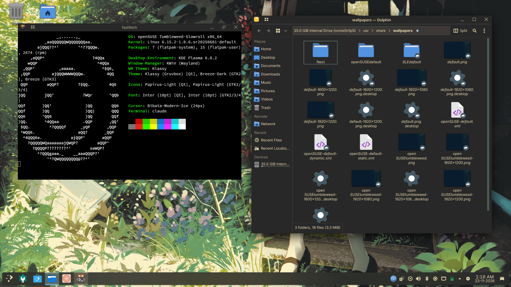
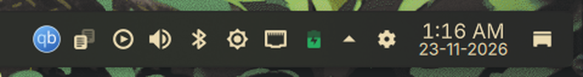
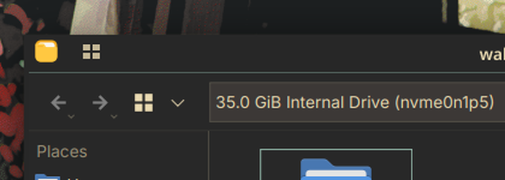

# Gruvbox Taskline (KDE Plasma 6)

One floating bottom panel over a dark Gruvbox desktop. Every running app gets a thin line in **its own icon's colour**, windows have **square corners**, and KDE Control Station's Tahoe layout holds the quick toggles. A sibling of [Gruvbox Klassy](../kde-gruvbox-klassy/): same colours, wallpaper, cursor and splash, but one panel instead of a top bar and dock.



| Taskbar | Tray, Control Station, clock | Square corners |
|---|---|---|
|  |  |  |

In the taskbar close-up, Dolphin is the active app (full-strength blue line on a tinted tile), Kitty is open in the background (dimmed line), and System Settings, Discover and Zen are pinned but not running (no line).

## What's in it

| Part | What | Source | Needs |
|---|---|---|---|
| Global theme | Breeze Dark | built in | |
| Plasma style | openSUSE, which follows the colour scheme, so panels and pop-ups are dark Gruvbox. Falls back to Breeze outside openSUSE | ships with openSUSE (`plasma6-theme-openSUSE`) | |
| Colours | Gruvbox | [printesoi/kde-gruvbox](https://github.com/printesoi/kde-gruvbox) | |
| Icons | Papirus-Light `20260801` | [PapirusDevelopmentTeam/papirus-icon-theme](https://github.com/PapirusDevelopmentTeam/papirus-icon-theme) | |
| Cursor | Bibata-Modern-Ice v2.0.7 | [ful1e5/Bibata_Cursor](https://github.com/ful1e5/Bibata_Cursor) | |
| Font | Inter 4.1, 10 pt, also the default `sans-serif` for other apps and web pages (fontconfig) | [rsms/inter](https://github.com/rsms/inter) | |
| Splash | Kuro the cat | [bouteillerAlan/kuro](https://github.com/bouteillerAlan/kuro) | |
| Wallpaper | Kita (downloaded at install) | [gruvbox-wallpapers](https://gruvbox-wallpapers.pages.dev/wallpapers/anime/Kita.png) | |
| Taskbar | **FancyTasksNG** v2.3.0, checksum-verified | [DayDve/FancyTasksNG](https://github.com/DayDve/FancyTasksNG) | |
| Quick settings | **KDE Control Station**, Tahoe layout | [EliverLara/kde-control-station](https://github.com/EliverLara/kde-control-station) | |
| Effects | Sheet (built in), **Geometry Change**, **Better Blur DX**. Rounded Corners stays off | [peterfajdiga/kwin4_effect_geometry_change](https://github.com/peterfajdiga/kwin4_effect_geometry_change), [xarblu/kwin-effects-better-blur-dx](https://github.com/xarblu/kwin-effects-better-blur-dx) | blur: sudo, compiled |
| Network speed | **Speeding Bullet**, live download/upload speed left of the tray, text at 115% | [strider-ape/speeding-bullet](https://github.com/strider-ape/speeding-bullet) | `vnstat` for the "Today's usage" pop-up |
| Window decoration + app style | **Klassy** with a 0 px corner radius | [paulmcauley/klassy](https://github.com/paulmcauley/klassy) | sudo, compiled |
| Login screen | **SilentSDDM** | [uiriansan/SilentSDDM](https://github.com/uiriansan/SilentSDDM) | sudo |

### Layout

```
╭──────────────────────────────────────────────────────────────────────────────╮
│ ✦  ⚙  🛍  📁  ◎  >_  …       ↓ 2.1M ↑ 40K       tray  ⚙   1:16 AM     ▭ │  44px, floating, full width
│              ▔▔  ▔▔                                       23-11-2026        │
╰──────────────────────────────────────────────────────────────────────────────╯
```

- **✦** is Plasma's application launcher.
- The pinned apps are System Settings, Discover, your file manager and your browser. Running apps get a line underneath in their icon's colour.
- **↓ ↑** before the tray is Speeding Bullet, the live network speed. Click it for today's usage.
- **⚙** after the tray is Control Station: Wi-Fi, Bluetooth, Do Not Disturb, Night Light, dark/light switch, KDE Connect, screenshot, volume, brightness and media.
- **▭** on the far right shows the desktop.

### Taskbar indicators

These are FancyTasksNG settings. Change them with right-click on the taskbar → *Configure Fancy Tasks NG* → *Indicators*.

| Setting | Value |
|---|---|
| Style | Line, one segment per window (up to 4) |
| Colour | Each app's dominant icon colour (*Use plasma accent color* off) |
| Inactive apps | Dimmed to 50% |
| Minimized apps | Greyed out |
| Thickness | 3 px, 4 px for the active app, roundness 2 |
| Hover zoom | Off |
| Unread badges | On (FancyTasksNG's default) |

FancyTasksNG's right-click menu lists recent items. To do that it reads your recent documents and browser history on your own machine; nothing is sent anywhere.

## Install

Captured from a live openSUSE Tumbleweed-Slowroll desktop with Plasma 6.8.3 on Wayland. The installer rebuilds that setup, but hasn't been run end to end on a fresh account yet.

```bash
git clone https://github.com/strider-ape/linux-themes.git
cd linux-themes/kde-gruvbox-taskline

sudo ../kde-gruvbox-klassy/install-system.sh   # 1. optional: Klassy, Better Blur DX, SilentSDDM
./install.sh                                   # 2. everything else, as your normal user
```

Then **log out and back in** so KWin loads the compiled effects and you see the Kuro splash and SilentSDDM login screen.

Step 1 is Gruvbox Klassy's system installer. It also builds Rounded Corners, which this theme leaves switched off. `install.sh` works without step 1; it then keeps your current window decoration and uses Plasma's own blur.

> ⚠️ **Panels other than your first one are removed.** Your clock and system tray settings carry over; every other widget on that panel is replaced.

### Options

| Variable | Default | Example |
|---|---|---|
| `LAUNCHERS` | System Settings, Discover, file manager, browser | `LAUNCHERS="preferred://filemanager,applications:kitty.desktop" ./install.sh` |
| `WALLPAPER` | `1` | `WALLPAPER=0 ./install.sh` keeps your current wallpaper |
| `FONT` | `1` | `FONT=0 ./install.sh` keeps your current font |

## After a Plasma update

- **FancyTasksNG and Control Station** are plain QML widgets, so they never need rebuilding. A big Plasma release can still break them until their developers catch up.
- **Klassy and Better Blur DX** are compiled against your exact Plasma version. If blur or the window decoration vanish after an update, rebuild them with `sudo ../kde-gruvbox-klassy/install-system.sh`. To confirm, check `journalctl --user -b | grep "needs to be rebuilt"`.

Known issue: Control Station 2.8.0 logs errors from its battery and power page on Plasma 6.8.3, so that page may not work fully.

## Undo

```bash
./uninstall.sh                       # restore the newest ~/plasma-backup-*
./uninstall.sh ~/plasma-backup-XYZ   # restore a specific backup
./uninstall.sh --purge               # ...and remove only what install.sh added
sudo ../kde-gruvbox-klassy/uninstall.sh --system   # remove Klassy, blur, corners, SilentSDDM
```

`install.sh` lists everything it adds in `~/.local/share/gruvbox-taskline/installed.txt`. `--purge` removes only those, so icons, fonts or widgets you already had stay.

## Differences from Gruvbox Klassy

- One bottom panel instead of a top bar and a dock. No Kara workspace pills, no Andromeda launcher.
- FancyTasksNG instead of Plasma's task manager.
- Square window corners: Rounded Corners off and Klassy's corner radius at 0.
- openSUSE Plasma style (dark, follows Gruvbox) instead of Breeze Light; Papirus-Light icons instead of Reversal; Inter font.
- No 90% window opacity rule. `install.sh` removes it if Gruvbox Klassy added it.

## Not included

- **Magic lamp minimize animation:** my fork of Yet Another Magic Lamp, at [strider-ape/kwin-effects-yet-another-magic-lamp-reloaded-for-6.4](https://github.com/strider-ape/kwin-effects-yet-another-magic-lamp-reloaded-for-6.4). It's compiled against your exact KWin version, so build it yourself if you want it.
