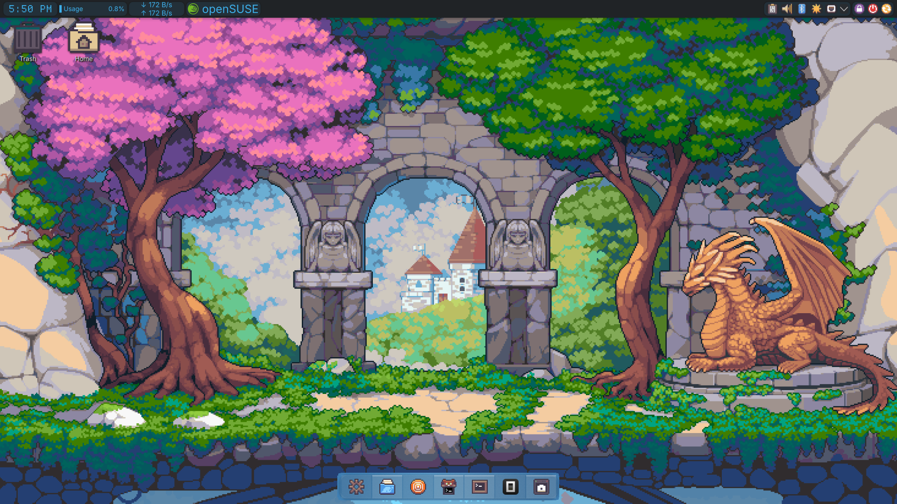
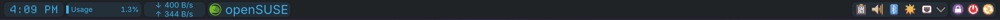
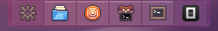

# Pixora Dual-Bar (KDE Plasma 6)

A pixel-art KDE setup with two bars: a thin top bar where each widget sits in its own rounded pill, and a floating dock at the bottom. Based on [this r/unixporn post](https://www.reddit.com/r/unixporn/comments/1w3eu13/kde_no_reason_to_switch_when_you_have_the_goat/).



**Top bar**


**Dock**



## What's in it

| Part | What | Source |
|---|---|---|
| Icons | **Pixora Dark**, a 16-bit pixel-art icon theme (Pixora and Pixora Accent are installed too) | [tsora1603/pixora-icons](https://github.com/tsora1603/pixora-icons) |
| Font | **DepartureMono Nerd Font**, used for the clock and the media widget | [Nerd Fonts](https://github.com/ryanoasis/nerd-fonts) v3.5.1 |
| Widget styling | **Panel Colorizer**: the "Rounded Widgets" preset on the top bar, "Dock" on the dock | [luisbocanegra/plasma-panel-colorizer](https://github.com/luisbocanegra/plasma-panel-colorizer) v8.1.0 |
| Media widget | **Plasmusic Toolbar**: album art and playback controls in the dock | [ccatterina/plasmusic-toolbar](https://github.com/ccatterina/plasmusic-toolbar) v4.3.1 |
| Network speed | **Speeding Bullet** | [strider-ape/speeding-bullet](https://github.com/strider-ape/speeding-bullet) |
| Wallpaper | Pixel-art ruins and dragon by **LorienPixel** (downloaded at install, not stored in this repo) | [wallhaven yqv55x](https://wallhaven.cc/w/yqv55x) · [artist](https://x.com/LorienPixel/status/2053839130778349801) |

### Layout

```
┌──────────────────────────────────────────────────────────────────────────────┐
│ [clock] [CPU %] [↓↑ net] [ distro menu]           [tray icons] [lock|reboot|off] │  top: 36px, full width
└──────────────────────────────────────────────────────────────────────────────┘

                    ╭───────────────────────────────────────╮
                    │ [♪ album art ⏮ ⏯ ⏭]  ⚙  📁  🌐  🐱  … │   dock: 56px, floating, centered
                    ╰───────────────────────────────────────╯
```

The media player in the dock only appears while something is playing.

## Install

You need KDE Plasma 6 (tested on 6.8, Wayland, openSUSE Tumbleweed) plus `git`, `curl`, `tar` and `python3`. Everything installs into `~/.local/share`, so no sudo is needed.

```bash
git clone https://github.com/strider-ape/linux-themes.git
cd linux-themes/kde-pixora-dualbar
./install.sh
```

That's it. The script:

1. Backs up your current Plasma config to `~/plasma-backup-<timestamp>/`
2. Downloads and installs the icons, font and widgets at the versions pinned in the script
3. Switches the icon theme to Pixora Dark
4. Downloads the wallpaper to `~/Pictures/Wallpapers/` and sets it
5. Rebuilds the panels: your first panel becomes the top bar and the dock is created fresh
6. Restarts plasmashell

> ⚠️ **Panels other than your first one are removed.** Your clock, system tray, app menu and Speeding Bullet settings carry over; every other widget on your panels is replaced.

### Options

Set these as environment variables before `./install.sh`:

| Variable | Default | Example |
|---|---|---|
| `LAUNCHERS` | System Settings, file manager, browser, kitty | `LAUNCHERS="preferred://filemanager,applications:org.kde.konsole.desktop"` |
| `MENU_LABEL` | First word of your distro name (`openSUSE`, `Arch`, …) | `MENU_LABEL="Start"` |
| `ICON_THEME` | `pixora-dark` | `ICON_THEME=pixora-accent` (folders follow your KDE accent color) |
| `WALLPAPER` | `1` | `WALLPAPER=0` keeps your current wallpaper |

```bash
MENU_LABEL="Arch" ICON_THEME=pixora-accent ./install.sh
```

## Undo

```bash
./uninstall.sh                 # restore the newest ~/plasma-backup-*
./uninstall.sh --purge         # ...and delete the icons, font and widgets
./uninstall.sh ~/plasma-backup-20261121-161059   # restore a specific backup
```

## Manual setup (if you'd rather click)

1. **Icons:** `git clone https://github.com/tsora1603/pixora-icons`, copy `pixora*` into `~/.local/share/icons/`, then pick it in *System Settings → Colors & Themes → Icons*.
2. **Font:** extract [DepartureMono.tar.xz](https://github.com/ryanoasis/nerd-fonts/releases/download/v3.5.1/DepartureMono.tar.xz) into `~/.local/share/fonts/` and run `fc-cache -f`.
3. **Widgets:** right-click the panel → *Add Widgets → Get New Widgets → Download New Plasma Widgets*, then install **Panel Colorizer** and **PlasMusic Toolbar**.
4. **Top bar:** move your panel to the top (Panel Configuration → Position), set the height to 36 and add widgets in this order: Digital Clock, CPU Usage, Speeding Bullet, Application Launcher, Spacer, Spacer, System Tray, Lock/Logout, Panel Colorizer. In Panel Colorizer's settings, load the **Rounded Widgets** preset.
5. **Clock:** right-click → Configure → Appearance. Set the font to *DepartureMono Nerd Font* at 13pt and turn off the date.
6. **CPU:** right-click → Configure → Appearance → Display Style: *Text Only*.
7. **Dock:** right-click the desktop → *Add Panel → Empty Panel*. Put it at the bottom, set the height to 56, turn on *Floating*, set Width to *Fit content* and Alignment to *Center*. Add PlasMusic Toolbar, Icons-only Task Manager and Panel Colorizer, then load the **Dock** preset.

## Tweaks and known gaps

- **Audio visualizer:** the original has one in the middle of the top bar. Install `cava` (`sudo zypper in cava` / `sudo pacman -S cava`) and a CAVA-based visualizer widget, then put it between the two spacers.
- **24h clock:** right-click the clock → Configure → Time display: *24-Hour*.
- **Different look:** Panel Colorizer ships about 30 presets (Blur Widgets, Neon Lights, ChromeOS, …). Open the Panel Colorizer settings on either bar and pick one.
- The desktop widgets from the original post (calendar, weather, clock, media) aren't included.

## Credits

Icons by [tsora1603](https://github.com/tsora1603/pixora-icons), Panel Colorizer by [luisbocanegra](https://github.com/luisbocanegra), Plasmusic Toolbar by [ccatterina](https://github.com/ccatterina), Departure Mono by [Helena Zhang](https://departuremono.com/), wallpaper by [LorienPixel](https://x.com/LorienPixel), inspired by the r/unixporn post linked above.
